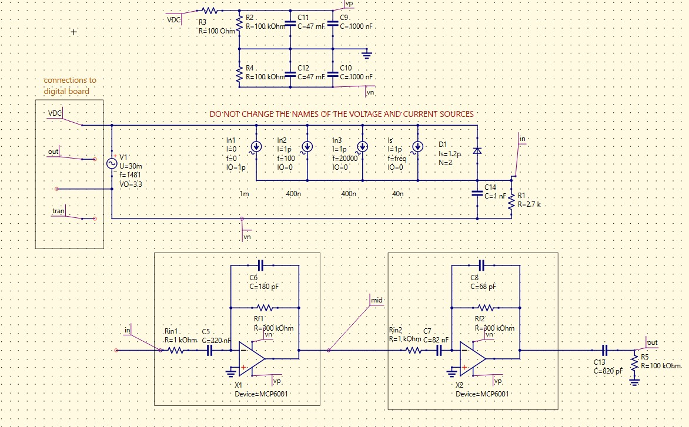
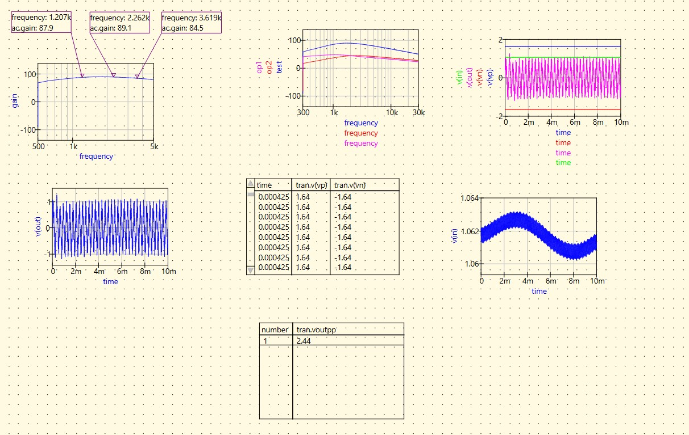
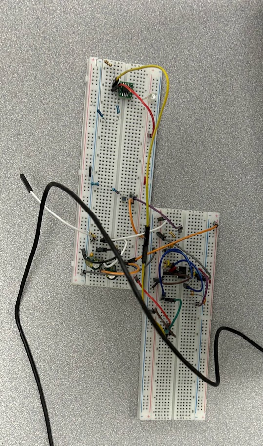
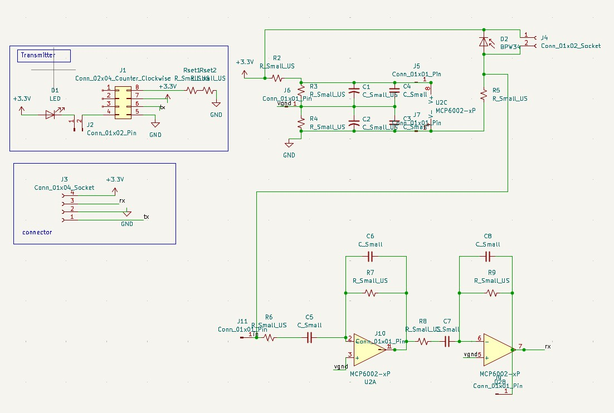
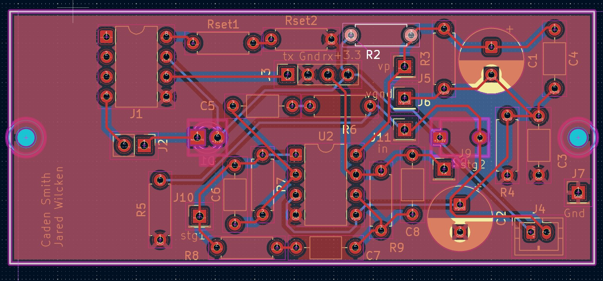
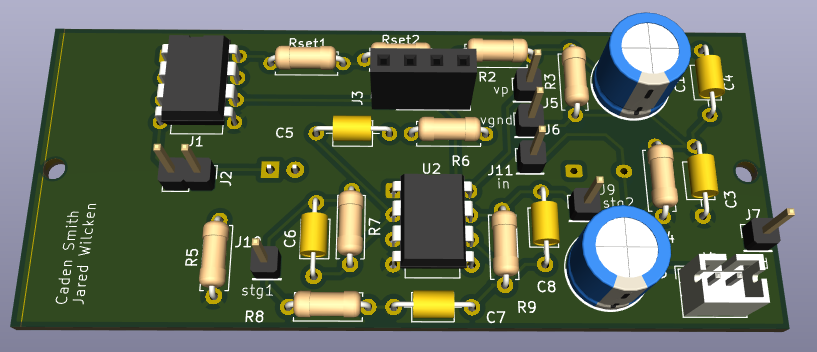
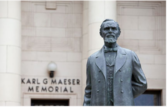

# Circuit Design and Laboratory Work

This page documents selected circuit design and laboratory projects completed in ECEN 340 at Brigham Young University. My work includes circuit simulation, PCB design, hardware prototyping, and laboratory testing.

## Laser-tag Reciever/Transmitter

### Overview

For this project, I designed and simulated a filter circuit using SPICE, then worked with physical circuit implementation and testing. Then, we moved to PCB design with KiCad. The project involves analyzing circuit behavior, evaluating design choices, and comparing theoretical expectations with practical results.

### SPICE Simulation (Reciever Only)

<!-- IMAGE PLACEHOLDER 1: Replace the filename below with your SPICE screenshot. -->

*Figure 1. SPICE schematic and simulation of the filter circuit.*

**Design and analysis**

* **Objective:** Reduce noise from the power supply and surrounding environment while amplifying frequencies associated with the desired signal.
* **Design approach:** Combined a voltage divider with two active band-pass filters and an additional low-pass filter to shape the circuit's frequency response.
* **Simulation:** Tested the circuit using multiple noise sources and analyzed the resulting signal. The simulated signal had a peak-to-peak voltage 0.4 V greater than that of the noise, which was greater than the 200mV requirement.
* **Key takeaway:** A reciever must account for source and environment noise while still amplifying the signal of interest.

### Physical Circuit Implementation

<!-- IMAGE PLACEHOLDER 2: Replace the filename below with your breadboard photo. -->

*Figure 2. Breadboard Implementation and Hardware Testing for both reciever and transmitter.*

**Design and Testing**

* **Objective:** Build and test the laser tag transmitter and receiver circuits on a breadboard.
* **Implementation:** Built the receiver circuit across two breadboards using MCP6002 operational amplifiers, resistors, capacitors, and a photodiode. The transmitter required surface-mount soldering an LED driver chip onto a breakout board.
* **Receiver testing:** Used an oscilloscope and FFT analysis to test signals at 1250 Hz, 2000 Hz, and 3636 Hz. At a sampling rate of 100 kHz, we measured a signal-to-noise difference of 0.333 V, passing the requirement of at least 100 mV.
* **Transmitter testing:** Measured an LED current magnitude of approximately 77.6 mA at 2000 Hz using oscilloscope data and FFT analysis.
* **Troubleshooting:** Reciever: we didn’t see any signal come through until we repositioned our photodiode current-to-voltage component. Transmitter: our transmitter didn't initially produce enough current. This is because we had a faulty LED component.
* **Key takeaway:** Building the circuit showed me that a working simulation doesn't always translate directly to physical hardware. Testing and troubleshooting are just as important as the circuit design itself.

### KiCad Schematic

<!-- IMAGE PLACEHOLDER 3: Replace the filename below with your kicad schematic. -->

*Figure 3. KiCad Schematic Design.*

**Design and Analysis**

* **Objective:** Convert our tested laser tag transmitter and receiver circuits into a KiCad schematic for PCB design.
* **Design approach:** Organized the receiver alongside the LED transmitter circuit while assigning appropriate symbols and footprints.
* **Design specifications:** Designed around a 3.3 V power supply, with the receiver intended to detect signals across the 1250–3636 Hz frequency range.
* **Verification:** Checked component connections and power connections before transferring the schematic into the PCB layout.
* **Key takeaway:** Creating a PCB schematic required more attention to component specifications (like pitch) and physical connections than the original SPICE simulation.

### PCB Design

<!-- IMAGE PLACEHOLDER 4: Replace the filename below with your kicab pcb and 3D rendering. -->

*Figure 4. KiCad PCB Design and 3D Rendering.*

**PCB Design and Layout**

* **Objective:** Convert our KiCad schematic into a PCB layout that fits inside the laser tag case.
* **Design approach:** Selected component footprints and arranged components on both sides of the board to connect the transmitter and receiver circuits.
* **Board specifications and statistics:** Designed a 74 × 32 mm PCB resulting in 33 components and 72 pads, with a minimum trace width of 0.305 mm and minimum clearance of 0.713 mm.
* **Verification:** Used KiCad's 3D viewer to check the physical layout before preparing the board for fabrication.
* **Key takeaway:** PCB design taught me to consider physical constraints and trace routing when designing a board.

## Tools and Technical Skills

* **Circuit simulation:** SPICE for modeling circuit behavior and evaluating designs.
* **PCB design:** KiCad for schematic capture and printed circuit board design.
* **Laboratory instrumentation:** Oscilloscope and function generator for applying signals, observing waveforms, and evaluating circuit performance.
* **Circuit prototyping:** Breadboarding, component selection, measurement, and debugging.

## Design Journey

This project has helped me connect circuit theory and simulation with physical implementation and laboratory measurement.

**What I learned:** I learned that simulations don't instantly convert to physical circuit boards. There are multiple stages in the design process and lots of troubleshooting. It is an iterative process.

**New Skills:** Through ECEN 340, I've learned how to simulate circuits in SPICE, build and troubleshoot them on a breadboard, and use KiCad to create schematics and PCB layouts. These are all skills that I've developed since the beginning of the semester. 

**Utilizing Feedback:** Based on feedback from my first portfolio checkpoint, I also added quantitative measurements and testing details to better demonstrate our circuit's performance.

**Next Steps:** Once our PCB's arrive from JLC, we will solder in our components and test our circuits performance using the same methods we used for the breadboard circuits.

## BYU AIMS

* **Spiritually Strengthening:**
* **Intellectually Enlarging:**
* **Character Building:**
* **Leading to Lifelong Learning and Service:** Throughout my time in this class, I've been continually amazed and impressed by my classmates. During junior year, everyone has so many commitments. However, I've seen so many classmates stop what they are doing to tutor me. This is one of the primary reasons why I have been successful this year. In turn, I've tried to emmulate their actions. I've enjoyed turtoring my friends in their sophmore classes. I'm realizing that a fulfilling life is marked by having an outward focus.

