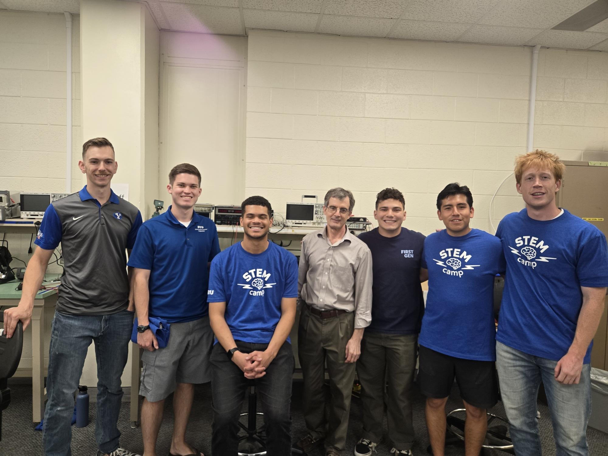
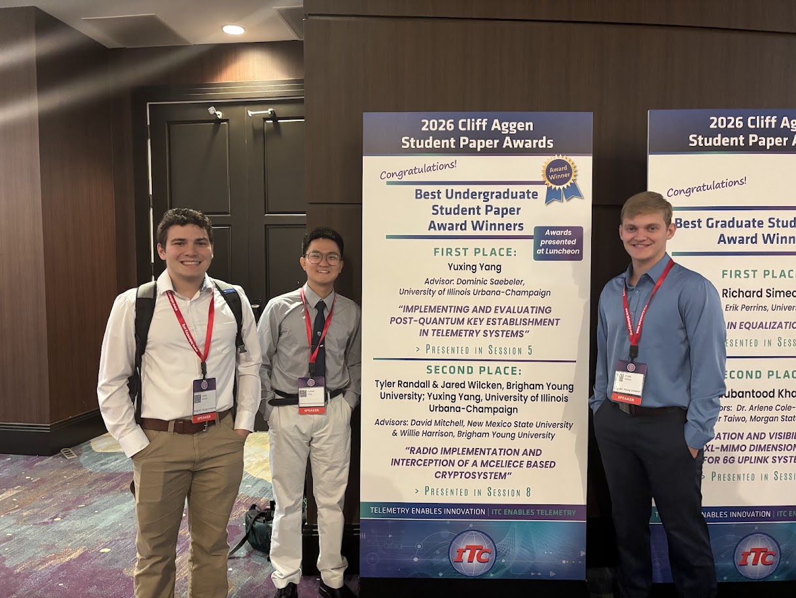

*Immerse 2026*

## Research Interests

* Post-Quantum Cryptography (PQC)
* Quantum Error Correction (QEC)

*International Telemetering Conference*
* Tyler Randall, Yuxing Yang, and I were able to present our research about an experiement we ran connecting Post-Quantum Cryptography and telemetry. 

<!--
## Projects

Summarize each research project, including its objective, your contribution, and outcomes.

## Methods and Equipment

Describe relevant analytical methods, instruments, software, and hardware.

## Related Publications

See the [Publications](/publications/) page for papers and other published work.
-->